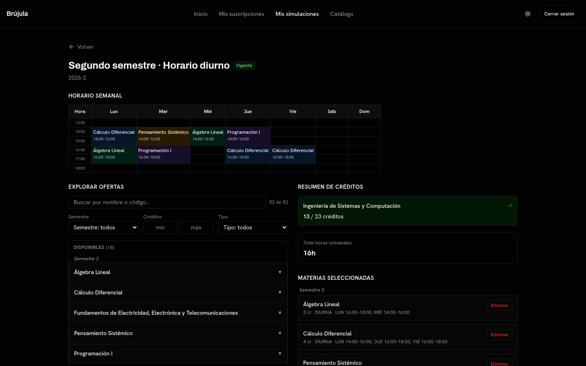
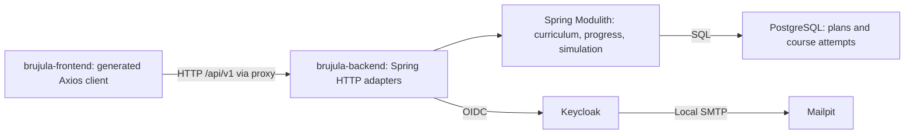

<!-- markdownlint-disable-next-line MD041 -->
<div align="center">

<h1>Brújula · API</h1>

<p><strong>Curriculum, progress, and semester scheduling for Universidad del Quindío students.</strong></p>

<p>
<a href="https://github.com/diegnghtmr/brujula-backend/actions/workflows/ci.yml"></a>


<a href="LICENSE"></a>
</p>

<p>
<a href="https://diegnghtmr.me/en/work/brujula/"><strong>Case study</strong></a> &bull;
<a href="#quick-start"><strong>Quick start</strong></a> &bull;
<a href="#architecture"><strong>Architecture</strong></a> &bull;
<a href="https://github.com/diegnghtmr/brujula-frontend"><strong>Frontend repo</strong></a>
</p>

</div>

<p align="center"></p>

<p align="center"><em>The API checks the selections and supplies the sessions and credit totals shown in the web app.</em></p>

A semester plan depends on more than which courses the curriculum recommends. Brújula combines the curriculum, the student's own course declarations, and offered sections to check what can fit together. It supports personal planning; it neither certifies grades nor registers students for classes.

## Features

- **Catalog and curricula.** Serve study plans, recommended semesters, course credits, and prerequisites.
- **Student progress.** Record course attempts by academic period and calculate passed courses, earned credits, and estimated averages.
- **Section simulation.** Check prerequisites, configured credit limits, and timetable overlaps before returning the weekly schedule.
- **Private declarations.** Keep individual self-reported grades and attempts private to the student; staff reporting is limited to aggregate data.
- **Session-based sign-in.** Integrate with Keycloak over OIDC while keeping identity tokens on the backend.
- **OpenAPI contract.** Generate Spring interfaces and models from the same spec that drives the companion Axios client.

## Quick start

Install Git, Docker with Compose, and JDK **25** for the host JVM workflow. The repository includes the Gradle **9.0.0** wrapper.

```sh
git clone https://github.com/diegnghtmr/brujula-backend.git
cd brujula-backend
docker compose -f ops/local/compose.yaml up -d
keycloak=http://localhost:8090
realm="$keycloak/realms/brujula-dev/protocol/openid-connect"
SPRING_SECURITY_OAUTH2_CLIENT_PROVIDER_KEYCLOAK_AUTHORIZATION_URI="$realm/auth" \
SPRING_SECURITY_OAUTH2_CLIENT_PROVIDER_KEYCLOAK_TOKEN_URI="$realm/token" \
SPRING_SECURITY_OAUTH2_CLIENT_PROVIDER_KEYCLOAK_JWK_SET_URI="$realm/certs" \
SPRING_SECURITY_OAUTH2_CLIENT_PROVIDER_KEYCLOAK_USER_INFO_URI="$realm/userinfo" \
BRUJULA_KEYCLOAK_AUTH_SERVER_URL="$keycloak" \
./gradlew bootRun --args='--spring.profiles.active=local'
```

Open [Swagger UI](http://localhost:8080/swagger-ui/index.html). The host command points Spring's Keycloak endpoints at the Compose-published port `8090` rather than the base configuration's `9090`. Mailpit is at <http://localhost:8025>. The [database setup and move guide](docs/database/change-pc-guide.md) covers host settings and backups.

For the full Compose stack, check out [brujula-frontend](https://github.com/diegnghtmr/brujula-frontend) alongside this repository and generate its API client using its Quick start before building the frontend image. From the backend root:

```sh
docker compose -f ops/local/compose.full.yaml up -d
```

Open <http://localhost:5173>. Vite previews the built client, forwarding OAuth routes and stripping `/api/v1` on API calls. A separate static production host needs an equivalent reverse proxy setup.

| Variable | Purpose | Default |
| --- | --- | --- |
| `SPRING_PROFILES_ACTIVE` | Select the Spring configuration. | `local` in full Compose |
| `SPRING_DATASOURCE_URL` | Host JVM JDBC override. | `jdbc:postgresql://localhost:5432/planner_db` under `local` |
| `SPRING_DATASOURCE_USERNAME`, `SPRING_DATASOURCE_PASSWORD` | Host JVM database account overrides. | Local development values |
| `BRUJULA_DB_URL`, `BRUJULA_DB_USERNAME`, `BRUJULA_DB_PASSWORD` | Full Compose API database overrides. | Internal PostgreSQL service and development account |
| `KEYCLOAK_CLIENT_SECRET` | Keycloak OIDC client secret for the `local` profile. | Local placeholder |
| `BRUJULA_FRONTEND_BASE_URL` | Browser origin used for redirects in base config. | `http://localhost:5173`; the `local` profile fixes this origin |
| `OIDC_REDIRECT_URI` | Browser-reachable auth callback in full Compose. | `http://localhost:8080/login/oauth2/code/keycloak` |
| `VITE_API_BASE_URL` | Full Compose frontend proxy target. | `http://backend:8080` |

## Architecture

[Spring Modulith](docs/architecture/adr/ADR-001-modular-monolith-vs-microservices.md) keeps catalog, curriculum, progress, offerings, and simulation in one process with explicit module boundaries. The [OpenAPI contract](openapi/brujula-api.v1.yaml) is authoritative; sync the copy in the frontend when an API change lands. See the [architecture decisions](docs/architecture/adr/) for identity, authorization, and contract conventions.



## Tech stack

| Layer | Technology |
| --- | --- |
| Runtime | Java 25, Spring Boot 4.0.3, Spring Modulith 2.0.2 |
| Data | PostgreSQL 18.4, Spring Data JPA, Flyway |
| Identity and development mail | Keycloak 26.4.5, Spring Security, Mailpit 1.27.3 |
| Build and contract | Gradle 9.0.0, OpenAPI Generator 7.14.0 |
| Checks | JUnit, Testcontainers 1.21.0, ArchUnit 1.4.1, Spotless, JaCoCo |

## Testing

```sh
./gradlew spotlessCheck
./gradlew test
./gradlew jacocoTestCoverageVerification
```

[CI](.github/workflows/ci.yml) runs these steps; Docker is required for the PostgreSQL integration tests. The coverage gate checks domain and application service packages. `./gradlew check` also includes OpenAPI validation. Tests cover module boundaries, course progress, prerequisites, and timetable conflicts.

## Project structure

```text
src/main/java/co/edu/uniquindio/brujula/  Application modules
src/main/resources/                      Runtime configuration and migrations
src/test/                                Unit, architecture, and integration tests
openapi/                                 Backend API contract
ops/local/                               Supporting services and full-stack Compose
```

## Related repositories

- [brujula-frontend](https://github.com/diegnghtmr/brujula-frontend) — curriculum browser, progress declarations, and schedule simulator.

## License

Released under the [MIT License](LICENSE).
