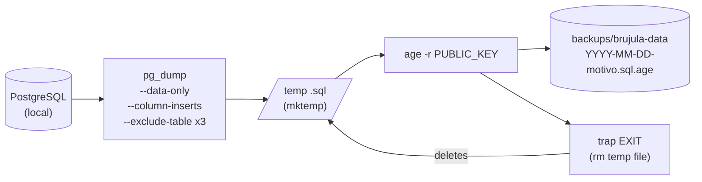
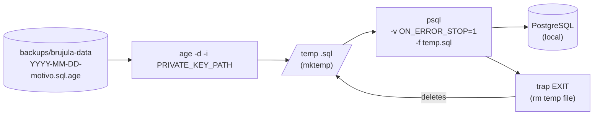

# Local-First Database Strategy

The Brujula database is local-first: **PostgreSQL is the real database** and runs on the
developer's machine. The GitHub repository is a reconstruction repo — it contains everything
needed to rebuild the schema and seed data from scratch, but it never stores live personal data.
Encrypted backup archives bridge the two: they are safe to commit and allow full data migration
across machines.

---

## The Four Pillars

| Pillar | Mechanism | Where it lives |
|--------|-----------|----------------|
| Schema versioning | Flyway migrations (`V<N>__description.sql`) | `src/main/resources/db/migration/` — committed |
| Seed / reference data | Flyway seed migrations (stable UUIDs, `ON CONFLICT DO NOTHING`) | Same directory — committed |
| Live data backups | `scripts/db/backup.sh` / `backup.ps1` → age-encrypted `.sql.age` | `backups/` directory — committed |
| Encryption key | `age-keygen` — generated once, kept outside the repo | Developer's Desktop — never committed |

---

## What Lives in the Repository vs. What Does Not

```
Repository (safe to push)             Developer's machine only
─────────────────────────────────     ────────────────────────────
src/main/resources/db/migration/      .env (real credentials)
  V001__init.sql                      brujula-key.txt (age private key)
  V002__...                           PostgreSQL data directory
  ...
backups/
  README.md                (log template + policy)
  brujula-data-*.sql.age   (encrypted — safe to commit)
.env.example               (placeholder values only)
scripts/db/                (backup.sh, restore.sh, backup.ps1, restore.ps1)
```

The `backups/` directory holds only ciphertext (`.sql.age` files). Plaintext `.sql` files are
blocked by `.gitignore` and must never appear there.

---

## Data Classification

| Category | Examples | In backup? | In repository? |
|----------|----------|-----------|----------------|
| Schema (DDL) | Tables, indexes, constraints | No — rebuilt by Flyway | Yes (migration SQL) |
| Seed / reference data | Programs, plan templates | No — rebuilt by Flyway seed migrations | Yes (migration SQL) |
| Live personal data | Student records, enrollments, compass entries | **Yes** — in `.sql.age` archives | No |
| Transient / session data | `spring_session`, `spring_session_attributes`, `idempotency_record` | **No** — intentionally excluded | No |

### Why Three Tables Are Excluded from Backups

| Table | Reason for exclusion |
|-------|----------------------|
| `platform.spring_session` | HTTP session tokens become invalid after restore; users re-authenticate automatically |
| `platform.spring_session_attributes` | Session attributes are tied to the transient session rows above |
| `platform.idempotency_record` | Deduplication fingerprints; restored data is already idempotent |

Restoring these tables would cause stale session conflicts and could silently break idempotency
guarantees. Excluding them is always correct.

---

## Flyway: Schema Versioning (RF-01)

Flyway manages all DDL. The application starts with `spring.jpa.hibernate.ddl-auto: validate`,
which means Hibernate **validates** the schema against entity mappings but never modifies it.
All structural changes must go through a numbered Flyway migration.

Convention: `V<N>__description.sql` where `<N>` is a zero-padded three-digit integer.
`spring.flyway.validate-on-migrate=true` (effective default) ensures migrations are consistent
before any application code runs.

Every migration file is committed in `src/main/resources/db/migration/`. The `.gitignore`
contains an explicit un-ignore rule (`!src/main/resources/db/migration/*.sql`) to ensure these
files are never accidentally blocked by the broad `*.sql` ignore rule.

---

## Seed Data: Idempotent Inserts (RF-02)

Seed migrations use stable, hard-coded UUIDs and `ON CONFLICT DO NOTHING` semantics. This means:

- Applying seeds on a fresh database always succeeds.
- Re-applying a seed migration (e.g., after manual `flyway_schema_history` cleanup) produces no
  duplicate-key errors.
- Seeds can be committed alongside schema migrations because they carry no personal data.

This policy applies to all new seed migrations going forward. Existing migrations (`V012`, `V013`,
and others) already follow this convention and must not be modified.

---

## Encryption Model

Backups use [age](https://github.com/FiloSottile/age) public-key encryption.

```
Backup flow:
  pg_dump  →  plaintext SQL (temp file)  →  age -r <PUBLIC_KEY>  →  .sql.age archive
                                                ↑ deleted by trap

Restore flow:
  .sql.age archive  →  age -d -i <PRIVATE_KEY_PATH>  →  plaintext SQL (temp file)  →  psql
                                                                     ↑ deleted by trap
```

The **public key** lives in `.env` as `AGE_PUBLIC_KEY`. It can be committed in plain text
(inside `.env.example` as a placeholder) because it is only used to encrypt.

The **private key** lives outside the repository — on the developer's Desktop or another
outside-repo location — and is referenced by `AGE_PRIVATE_KEY_PATH` in `.env`. It must never
be inside the project directory. The `.gitignore` blocks `brujula-key.txt`, `*.key`, and `*.pem`
as a safety net.

---

## Data Flow Diagrams

### Backup: encrypt and archive



### Restore: decrypt and load



---

## Naming Convention for Archives

```
backups/brujula-data-YYYY-MM-DD-<motivo>.sql.age
                                 ^^^^^^^
                                 Short slug identifying the reason.
                                 Allowed characters: [a-zA-Z0-9_-]
                                 Examples: before-migration, after-enrollment, manual
```

---

## Next Steps

| Task | Guide |
|------|-------|
| Create a backup | [backup-guide.md](backup-guide.md) |
| Restore a backup | [restore-guide.md](restore-guide.md) |
| Move to a new machine | [change-pc-guide.md](change-pc-guide.md) |
